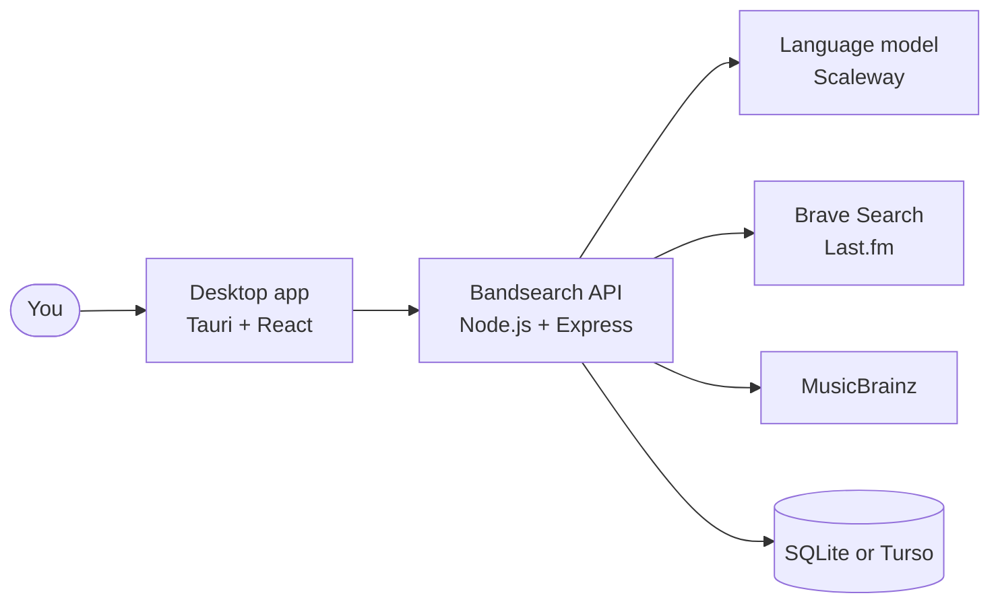
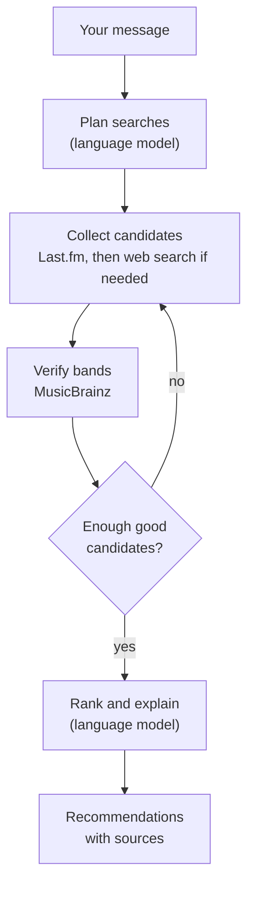

# Bandsearch

[](https://github.com/eikrad/bandsearch-app/actions/workflows/ci.yml)

[](https://github.com/eikrad/bandsearch-app/releases)

AI-powered music recommendations for niche and lesser-known artists. Describe bands you love, and Bandsearch surfaces similar but lesser-known picks — verified against MusicBrainz and ranked by a language model hosted in the EU (Scaleway).

Bandsearch is a chat-style desktop app (Linux, Windows, macOS) backed by a Node.js API that you can run locally or host yourself. It is in **alpha**: usable, actively developed, and still changing.

## What it does

- **Finds the small bands** — you name bands or describe a sound; a language model plans targeted web searches (Brave) and reads Last.fm's similar-artist lists to collect candidates.
- **Checks every suggestion** — each band is verified against a real MusicBrainz record before it is shown, and each pick comes with a short explanation and the sources behind it.
- **Lets you choose how obscure** — *Cult Following*, *Underground* or *Truly Obscure*, each a range of Last.fm listeners.
- **Holds a conversation** — follow-ups like "more" or "heavier" are answered from bands the chat already found, within seconds; bands already shown are not repeated.
- **Remembers your taste** — save bands, rate them, add categories and notes, and group them; preference-aware searches take your saved bands into account.
- **Keeps searching when you leave** — a search runs on the server; close the app and it picks the answer up when you come back.
- **Speaks your language** — the app's screens are in English, German or Danish, and the chat replies in the language you write in.
- **Your data, your choice** — SQLite by default, Turso for cloud sync; export or delete your account from Settings.

## How it works



The desktop app starts the API on your machine, or connects to a hosted one. A new search runs like this:



The full pipeline, its state and its limits are described in [docs/architecture/ARCHITECTURE.md](docs/architecture/ARCHITECTURE.md).

## Quick start

You need **Node.js 26.12.1+** (see `.nvmrc`), npm, a [Scaleway Generative APIs](https://www.scaleway.com/en/generative-apis/) key and a [Brave Search API](https://brave.com/search/api/) key.

```bash
git clone https://github.com/eikrad/bandsearch-app
cd bandsearch-app
npm install
cp .env.example .env        # add SCW_SECRET_KEY and BRAVE_API_KEY
npm run dev                 # API on http://localhost:3001
```

Ask it something:

```bash
curl -X POST http://localhost:3001/recommendations \
  -H "content-type: application/json" \
  -d '{"query": "I like Alcest and Agalloch"}'
```

To use the desktop app instead, install [Rust](https://rustup.rs) and your platform's build tools, then run `npm run desktop`. It opens a window and starts the API for you; enter your keys under **Settings**. Platform prerequisites and the one-time Node sidecar link are in [docs/development.md](docs/development.md#desktop-app-tauri).

Installers for Linux, Windows and macOS are attached to each [GitHub release](https://github.com/eikrad/bandsearch-app/releases); on Windows and Linux the app offers new versions as a one-click update.

## Configuration

Configuration is by environment variables. [`.env.example`](.env.example) lists them all with comments; only `SCW_SECRET_KEY` and `BRAVE_API_KEY` are required. Useful optional ones:

- `LASTFM_API_KEY` — Last.fm similar artists, listener counts and biographies (better obscurity targeting)
- `PREFERENCE_STORE` — `sqlite` (default), `memory`, `turso` or `turso-sync`
- `AUTH_MODE` — `progressive` (default, personal use) or `enforced` (closed, invite-only deployment)

The full table, storage backends, authentication modes and hosting on Render are in [docs/deployment.md](docs/deployment.md).

## Project structure

```
apps/desktop/     Tauri + React desktop app
services/api/     Express API with the LangGraph research pipeline
services/eval/    golden dataset, eval runner, run history and dashboard
shared/schemas/   shared TypeScript contracts (API shapes, artist identity)
tests/e2e/        Playwright end-to-end tests
docs/             architecture, decisions, guides and roadmap
```

**Tech stack:** TypeScript throughout · Express · LangGraph / LangChain · Scaleway Generative APIs · Brave Search · MusicBrainz · Last.fm · Tauri v2 (Rust) + React · SQLite / Turso.

## Documentation

| Read this | For |
|-----------|-----|
| [docs/README.md](docs/README.md) | Index of all documentation |
| [docs/development.md](docs/development.md) | Local setup, desktop app, tests, translations |
| [docs/deployment.md](docs/deployment.md) | Configuration, storage, auth, hosting, privacy |
| [docs/architecture/ARCHITECTURE.md](docs/architecture/ARCHITECTURE.md) | How the system works |
| [docs/evaluation.md](docs/evaluation.md) | Measuring recommendation quality |
| [docs/releasing.md](docs/releasing.md) | Versions, releases and in-app updates |
| [docs/ROADMAP.md](docs/ROADMAP.md) | What is done and what comes next |
| [CONTEXT.md](CONTEXT.md) | Glossary of the project's terms |

## Privacy

Your search text goes to Scaleway (language model, hosted in France) and Brave Search; only artist names go to MusicBrainz and, if enabled, Last.fm. Your account data stays in the database you choose. Recommendations are marked as AI-generated. The privacy policy is in the app under **Settings → Privacy & data**; details are in [docs/deployment.md](docs/deployment.md#privacy-and-transparency).

## Contributing

Contributions are welcome. Please read [CONTRIBUTING.md](CONTRIBUTING.md) (branching, checks, Conventional Commits) and the [Code of Conduct](CODE_OF_CONDUCT.md). Report security issues privately as described in [SECURITY.md](SECURITY.md), not as public issues.

## Acknowledgements

- [MusicBrainz](https://musicbrainz.org) — open music encyclopedia for artist metadata (CC0 1.0)
- [Scaleway Generative APIs](https://www.scaleway.com/en/generative-apis/) — EU-hosted models for recommendations (DeepSeek V4 Flash) and the quality judge (Gemma 4)
- [Brave Search](https://brave.com/search/api/) — web search for niche artist discovery
- [Last.fm](https://www.last.fm/api) — similar artists and listener counts
- [LangChain / LangGraph](https://www.langchain.com) — structure for the model calls and the research pipeline
- [Tauri](https://tauri.app) — the native desktop shell

## License

Apache 2.0 — see [LICENSE](LICENSE).
