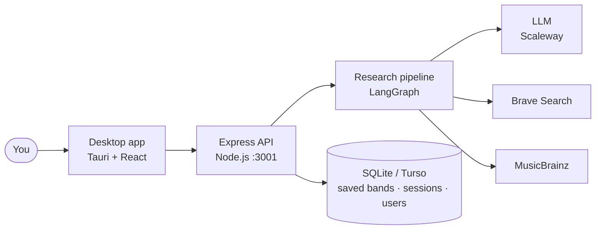
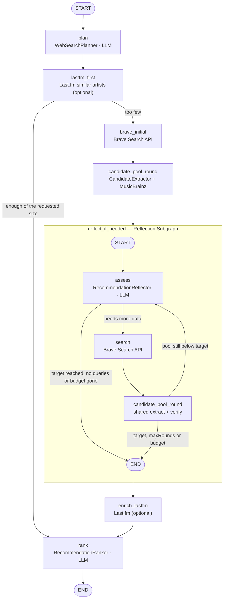

# Bandsearch

[](https://github.com/eikrad/bandsearch-app/actions/workflows/ci.yml)

[](https://github.com/eikrad/bandsearch-app/releases)

AI-powered music recommendations for niche and lesser-known artists. Describe bands you love, and Bandsearch surfaces similar but lesser-known picks — verified against MusicBrainz and ranked by a language model (Scaleway-hosted by default).

## Features

- **Niche artist discovery** — an LLM plans targeted Brave searches (FFO/Bandcamp-style) to find obscure artists that match your taste
- **MusicBrainz verified** — every suggestion is checked against real artist records (mbid, name, tags, life span)
- **Preference memory** — save bands without a rating, rate them when ready, and add categories or notes. Actions on earlier recommendation cards keep the selected artist's identity; later recommendations preserve your annotations. Future recommendations adapt to your saved preferences.
- **English, German and Danish** — the app's screens follow your system's language, or the one you pick under Settings → Language. The chat replies, and writes each recommendation's explanation, in the language of your message. The chat screen and the privacy policy are still English; they follow (#329)
- **Reflection loop** — if the first search pass is thin, the AI generates refined queries and searches again (up to 2 extra rounds)
- **Searches that outlive the app** — a search keeps running on the server when the phone's screen turns off or the app is closed, and the app picks up its answer when you come back (ADR 0006)
- **Native desktop app** — Tauri shell for Linux, macOS, and Windows; API keys stored in the OS config directory
- **Flexible storage** — SQLite by default, Turso for shared/cloud deployments
- **Optional multi-user auth** — activates automatically once you register the first account; single-user setups need no config. A hosted deployment can run closed (`AUTH_MODE=enforced`, email-bound invite codes)

## How it works

Bandsearch is a desktop app (Tauri + React) that talks to a Node.js API. The API runs a research pipeline against three external services and stores your data in SQLite or Turso.



A chat message does not always need a search: "more" or "heavier" is answered from the bands the conversation already found, a question about them in words, both within a few seconds ([conversation turns](docs/architecture/ARCHITECTURE.md#conversation-turns)). A search runs the pipeline:



See [`docs/architecture/ARCHITECTURE.md`](docs/architecture/ARCHITECTURE.md) for a full description of all nodes, state fields, and design decisions.

---

## Documentation

Everything beyond this README lives in [`docs/`](docs/README.md), which has an index with a one-line description per document: architecture, roadmap, ADRs, release process, evaluation, UI design specs.

---

## Tech Stack

| Layer | Technology |
|-------|------------|
| API server | Express.js + TypeScript (Node.js 26.12.1+) |
| AI pipeline | LangGraph + Scaleway Generative APIs (DeepSeek V4 Flash by default) |
| Web search | Brave Search API |
| Artist verification | MusicBrainz |
| Desktop shell | Tauri v2 (Rust) + React + TypeScript |
| Database | SQLite / Turso (pluggable) |
| Auth | bcrypt + JWT (30-day sessions) |

---

## Quick Start

**Prerequisites:** Node.js 26.12.1+ (the version in `.nvmrc`) and npm. npm is the only package manager: `package-lock.json` is the one lockfile, and `devEngines` in `package.json` says so.

```bash
git clone https://github.com/eikrad/bandsearch-app
cd bandsearch-app
npm install
cp .env.example .env        # then add SCW_SECRET_KEY and BRAVE_API_KEY
npm run dev                 # API starts on http://localhost:3001
```

Preferences are saved automatically to `bandsearch.db` — no database setup needed.
Both `SCW_SECRET_KEY` (Scaleway) and `BRAVE_API_KEY` are required to start the API.

Test it:

```bash
curl -X POST http://localhost:3001/recommendations \
  -H "content-type: application/json" \
  -d '{"query": "I like Alcest and Agalloch"}'
```

That waits for the answer. The app instead starts a search job and follows it,
which survives a dropped connection (see
[ARCHITECTURE.md § Search jobs](docs/architecture/ARCHITECTURE.md#search-jobs)):

```bash
curl -X POST http://localhost:3001/recommendations/jobs \
  -H "content-type: application/json" \
  -d '{"query": "I like Alcest and Agalloch"}'          # → {"jobId":"…"}
curl -N -H "accept: text/event-stream" http://localhost:3001/recommendations/jobs/<jobId>
```

When all 200 job slots are running, a search from another user is refused with
`503 search_capacity_exceeded`; retry later. Replacing your own running search
stays possible.

---

## Desktop App (Tauri)

**Additional prerequisites:** [Rust](https://rustup.rs) + platform build tools (see below)

```bash
npm run desktop             # opens native window, starts API automatically
```

Tauri expects a Node sidecar next to the Rust crate (`bundle.externalBin`). For local
dev, symlink your system Node once (the file is gitignored):

```bash
# Linux / macOS — use the host triple from: rustc -vV | grep ^host
ln -sf "$(which node)" apps/desktop/src-tauri/binaries/node-$(rustc -vV | sed -n 's/^host: //p')
```

On Windows, copy `node.exe` to
`apps/desktop/src-tauri/binaries/node-x86_64-pc-windows-msvc.exe` instead.

### Adding a Tauri command

Tauri rejects any app command the window has no permission for. To add one:

1. Write the `#[tauri::command]` function in `apps/desktop/src-tauri/src/main.rs`.
2. Add its name to the list in `apps/desktop/src-tauri/src/app_commands.rs`. That one
   list registers the command and generates its `allow-<name>` permission.
3. Grant `"allow-<name-with-dashes>"` in `apps/desktop/src-tauri/capabilities/default.json`.
4. Build once (`cargo check` in `apps/desktop/src-tauri`) and commit the regenerated
   `gen/schemas/`. When you remove a command, delete the ignored
   `apps/desktop/src-tauri/permissions/autogenerated/` first: Tauri never deletes its
   generated files, so a stale permission would otherwise stay in `gen/schemas/`.

Forgetting step 3 fails the build; `npm test` and `cargo test` check the same.

### Platform prerequisites

**Linux:**
```bash
# Arch / Manjaro
sudo pacman -S webkit2gtk-4.1 libappindicator-gtk3 librsvg

# Debian / Ubuntu
sudo apt install libwebkit2gtk-4.1-dev libappindicator3-dev librsvg2-dev patchelf
```

**macOS:** Xcode Command Line Tools (`xcode-select --install`). No additional packages needed.

**Windows:** [Visual Studio Build Tools](https://visualstudio.microsoft.com/visual-cpp-build-tools/) with the **Desktop development with C++** workload. WebView2 is built into Windows 10 1803+ and Windows 11.

### API key storage

Keys are written to the OS config directory as `bandsearch/config.json`. Use **Settings** in the app header to save your Scaleway and Brave keys. A Gemini key stored by an earlier version is removed, since the API no longer uses Gemini.

| OS | Path |
|----|------|
| Linux | `~/.config/bandsearch/config.json` |
| macOS | `~/Library/Application Support/bandsearch/config.json` |
| Windows | `%APPDATA%\bandsearch\config.json` |

If a recommendation call fails, the chat view shows a banner with a short, human-readable hint.

---

## Authentication

Local multi-user auth (bcrypt + 30-day JWT) with two modes, chosen by `AUTH_MODE`.

### `progressive` (default)

For a personal install. Behaviour depends on how many users are registered:

| Users registered | Behaviour |
|-----------------|----------|
| 0 | Pass-through — all requests accepted, no token needed |
| 1 | Auto-attach — requests are automatically associated with the single user, even without a valid token |
| ≥ 2 | Enforced — `Authorization: Bearer <token>` required for preference endpoints |

Anyone who can reach the URL can register. Do not expose this mode to the internet.

### `enforced` (closed beta, used by `render.yaml`)

For a hosted deployment with a known set of testers ([ADR 0005](docs/adr/0005-closed-beta-via-email-bound-invites.md)):

- Every protected request needs a valid token for a user that exists and is not disabled — no pass-through at 0 users, no auto-attach at 1. `/artists/*` is protected too. `/health`, `/version` and `/auth/*` stay public.
- `JWT_SECRET` is required; the server refuses to start without it.
- `POST /auth/register` needs an `inviteCode`. An invite is bound to one email address, can be used once, and expires after 14 days. A missing, wrong, expired, used, revoked or wrong-address code all get the same `403 invite_invalid` answer.
- `GET /auth/status` reports `authMode` and `inviteRequired`; the desktop app shows an "Invite code" field accordingly.
- `/auth/register`, `/auth/login` and `/auth/reset-password` are limited to 20 requests per 15 minutes per client IP (`429 rate_limit_exceeded`).

The email address is **not verified**. The invite code is the secret; binding it to an address means the new account carries the address you invited, and a forwarded code does not work for anyone else.

### Administering a closed beta

There is no admin UI or admin endpoint: the admin is whoever holds the database credentials. The commands use the same database as the server (Turso when `PREFERENCE_STORE` is `turso` or `turso-sync` — set `TURSO_DATABASE_URL` and `TURSO_AUTH_TOKEN` — otherwise the local SQLite file):

```bash
npm run invite:create --workspace @bandsearch/api -- --email tester@example.com [--days 14]   # prints the code once
npm run invite:list   --workspace @bandsearch/api
npm run invite:revoke --workspace @bandsearch/api -- --email tester@example.com
npm run user:disable  --workspace @bandsearch/api -- --email tester@example.com   # locks them out on their next request
npm run user:enable   --workspace @bandsearch/api -- --email tester@example.com
npm run feedback:list --workspace @bandsearch/api -- [--days 7] [--json]   # what testers said about their recommendations
```

`feedback:list` prints the recommendation feedback of the last N days (7 by default): counts per type, then each verdict with the tester's address, the query, mode, obscurity target and the bands shown. `--json` gives the rows for a spreadsheet or script. Feedback is kept for 90 days.

Only the SHA-256 hash of a code is stored, so a lost code cannot be shown again: revoke and issue a new one. To bootstrap a fresh deployment, run `npm run migrate:turso` first (migration `005` adds the `invites` table and `users.disabled_at`, `006` the recommendation feedback table), then create an invite for yourself.

### Registration switch and recovery

`REGISTRATION_OPEN=false` closes `POST /auth/register` completely, in either mode (in `enforced` mode that also stops invited registrations). Registering returns a JWT and a **recovery code**. Store the recovery code safely — it is the only way to reset your password. Tokens expire after 30 days. Set `JWT_SECRET` for sessions that survive restarts.

---

## Privacy & transparency

Bandsearch is a minimal-risk AI system under the EU AI Act, and the transparency
duty in Art. 50 applies to it. Two disclosures ship in the UI: a permanent line
in the chat composer stating that a language model hosted in the EU (Scaleway, France) writes the recommendations, and a
per-recommendation "AI-generated, not human-curated" caption. Recommendation
cards also carry `data-ai-generated="true"`, and a finished search returns
`aiGenerated`, `generatedAt`, `pipelineVersion` and the generating `model` in
its `meta`.

The privacy policy lives in `apps/desktop/src/ui/privacyPolicyText.ts` and is
readable in-app at `#/privacy`, linked from **Settings → Privacy & data**. It
names every processor that receives data (Scaleway, Brave Search, MusicBrainz,
optional Last.fm and Turso), the lawful basis for each kind of processing, the
retention periods, and how to exercise your rights.

Two GDPR endpoints back the Settings controls:

| Endpoint | Purpose |
|----------|---------|
| `GET /account/export` | Art. 15/20 — everything held about the account: profile, saved bands, groups, chat sessions with messages, feedback |
| `POST /account/delete` | Art. 17 — erases every user-scoped row, password-confirmed |

Account-database erasure uses explicit deletes driven by the shared
`USER_SCOPED_TABLES` list (`services/api/src/privacy/userDataStore.ts`), in one
transaction. Recommendation feedback lives in the same database as the rest of
the account, so it is exported and erased with it. A schema test checks that
every table with a `user_id` column belongs to the erasure list.

---

## Storage

`PREFERENCE_STORE` selects preferences, artist groups, users, invites, chat
sessions and recommendation feedback together, despite its name. Account export
and deletion cover that one database. Startup refuses an unavailable selected
backend rather than substituting another store. Eval telemetry never lives on
Turso: with `EVAL_DASHBOARD_ENABLED=true` it goes to the local SQLite file at
`DATABASE_PATH`, otherwise nothing is recorded.

| `PREFERENCE_STORE` | Description |
|--------------------|-------------|
| `sqlite` (default) | Local file, zero-config, data survives restarts |
| `memory` | In-process only, data lost on restart |
| `turso` | Turso cloud SQLite — every statement goes over the network |
| `turso-sync` | Local replica synced with Turso Cloud — reads and writes stay local, so the app keeps working offline |

SQLite account repositories share one connection, including when no path is
supplied and the database is `:memory:`. In `memory` mode all account repositories
are ephemeral; account export and deletion report unavailable. Optional eval
telemetry keeps its own connection to `DATABASE_PATH`. Recommendation feedback
(`POST /recommendations/:eventId/feedback`) works with the eval dashboard off,
takes its owner from the authenticated identity, ignoring any `userId` in the
request body, and carries the batch it judges. It is kept for 90 days.

See `.env.example` for the connection variables needed for each backend (`TURSO_DATABASE_URL`, `TURSO_AUTH_TOKEN`, `TURSO_SYNC_PATH`).

---

## Configuration

Required variables:

| Variable | Description |
|----------|-------------|
| `SCW_SECRET_KEY` | Scaleway Generative APIs — required (the default LLM provider); also enables the LLM judge |
| `BRAVE_API_KEY` | Brave Search token for niche artist discovery |

Common optional variables:

| Variable | Default | Description |
|----------|---------|-------------|
| `LLM_PROVIDER` | `scaleway` | Research provider; `scaleway` is the only one ([ADR 0004](docs/adr/0004-llm-models-per-role-on-scaleway.md)) |
| `SCW_MODEL` | `deepseek-v4-flash-0731` | Research model on Scaleway, chosen by the model comparison (ADR 0004) |
| `SCW_JUDGE_MODEL` | `gemma-4-26b-a4b-it` | LLM-as-judge model; must differ from the research model; recorded as `model_id` on every score row |
| `SCW_REASONING_EFFORT` / `SCW_JUDGE_REASONING_EFFORT` | `none` | Scaleway reasoning per role; `none` keeps calls fast (gemma: 101 s → 9 s for one extraction). `gpt-oss-120b` needs `low` or higher |
| `SCW_BASE_URL` | `https://api.scaleway.ai/v1` | Project-scoped Scaleway endpoint, if you use one |
| `PORT` | `3001` | API port |
| `AUTH_MODE` | `progressive` | `enforced` closes the deployment: tokens always required, registration by invite only ([ADR 0005](docs/adr/0005-closed-beta-via-email-bound-invites.md)) |
| `JWT_SECRET` | *(auto-generated)* | Set for persistent sessions across restarts; required when `AUTH_MODE=enforced` |
| `REGISTRATION_OPEN` | `true` | `false` rejects every `POST /auth/register` |
| `PREFERENCE_STORE` | `sqlite` | `sqlite`, `memory`, `turso`, or `turso-sync` |
| `TURSO_SYNC_PATH` | `bandsearch-sync.db` | Local replica file used by `turso-sync` |
| `LASTFM_API_KEY` | — | Last.fm fallback for artist images and obscurity scoring |
| `LANGSMITH_API_KEY` | — | LangSmith distributed tracing |
| `RESEARCH_TIMEOUT_MS` | `180000` | Total graph deadline, including retries and ranking; reserves up to 20 s (at most one third) for ranking, cancels research at the cutoff, and fails the request (`502 recommendation_unavailable`) if ranking cannot finish |
| `RESEARCH_TARGET_VERIFIED_CANDIDATES` | `8` | Verified bands needed before the reflection loop stops |
| `RESEARCH_MAX_INITIAL_SEARCHES` / `RESEARCH_MAX_REFLECTION_SEARCHES` / `RESEARCH_TOTAL_SEARCH_BUDGET` | `6` / `4` / `10` | Brave search caps for the first pass, for reflection, and in total |
| `CORS_ORIGIN` | `*` (`.env.example` sets `http://localhost:1420`) | Allowed browser origin for the API |
| `EVAL_RETENTION_DAYS` | `90` | How long recommendation events are kept before the daily purge removes them |

See `.env.example` for all options including storage backends, timeouts, search budgets, and CORS settings.

---

## Deployment

The API is a standalone Express service and can run anywhere Node.js 26.12.1+ is available. Render takes the Node version from `.nvmrc`, which also sets the CI Node and the Node bundled with the desktop installers. `render.yaml` at the repo root configures a [Render](https://render.com) Web Service (`bandsearch-api`, Node environment, Frankfurt region, `npm start`) as the supported hosted option, deploying from `main` — feature work happens on `staging` (see [`CONTRIBUTING.md`](CONTRIBUTING.md)) and only reaches production once merged to `main`.

Recommended production setup is `PREFERENCE_STORE=turso`, so the API stays stateless and all data (preferences, sessions, auth) lives in Turso/libSQL:

1. Create a Turso database, then run the migration once against it:
   ```bash
   TURSO_DATABASE_URL=... TURSO_AUTH_TOKEN=... npm run migrate:turso --workspace @bandsearch/api
   ```
2. Configure the secrets Render does not store in `render.yaml` — via the Render dashboard, not GitHub: `SCW_SECRET_KEY` (a key of its own, not the one for local evals), `BRAVE_API_KEY`, `TURSO_DATABASE_URL`, `TURSO_AUTH_TOKEN`, `JWT_SECRET`. `render.yaml` sets `AUTH_MODE=enforced`, so run the migration (step 1) before deploying and then create your first invite (see [Authentication](#authentication)). These are prompted for once when the Blueprint is first created and are not synced from `render.yaml` on later updates.
3. In the desktop app's Settings screen, point the API endpoint at the deployed URL instead of the local sidecar (leave it unset to keep using localhost).

**Free-tier limitations:** Render's free tier spins down after 15 minutes of inactivity, so the first request after a cold start can take 30-60 seconds, and it carries no SLA or uptime guarantee. The desktop app softens this: it wakes a hosted API when the user comes back and keeps it awake while the app is in use. For an always-on deployment, upgrade the service to the Starter plan ($7/month) in the Render dashboard.

---

## Desktop releases

Versions, the CHANGELOG and releases come from [release-please](https://github.com/googleapis/release-please) and Conventional Commit messages; nobody edits a version number by hand. The full flow, including how to merge each kind of pull request, is in [docs/releasing.md](docs/releasing.md). In short:

1. Changes reach `main` via feature branch → `staging` → `main`.
2. Every push to `main` opens or updates a `chore(main): release X.Y.Z` pull request. Merging it tags `vX.Y.Z` and creates a **draft** GitHub release.
3. [`.github/workflows/release.yml`](.github/workflows/release.yml) then builds the Linux, Windows and macOS installers: each OS downloads the matching Node sidecar into `apps/desktop/src-tauri/binaries/`, and `tauri-apps/tauri-action` uploads the installers and `latest.json` into the draft.
4. Only when every build has passed is the draft published and marked **latest**. The in-app updater offers a release only from that moment.

Pushing a tag no longer starts a build. For a test build, run **Actions → Build desktop installers → Run workflow** with a tag such as `v0.4.2-test`; it builds into a new draft prerelease.

Signing keys, the required GitHub secrets and the in-app update banner are described in [docs/releasing.md](docs/releasing.md#signing-and-in-app-updates).

---

## Development

```bash
npm test          # run all workspace tests
npm run ci        # lint + typecheck + test
npm run test:e2e  # Playwright end-to-end smoke tests (spins up the API and a static frontend)
```

Lint, typecheck and tests run automatically before every commit via a pre-commit hook (installed by `npm install`). CI runs on both `ubuntu-latest` and `windows-latest` via a GitHub Actions matrix.

### Translations (English, German, Danish)

The app's text lives in `apps/desktop/src/i18n/locales/`. English (`en.json`) is
the source; German and Danish are drafted by a model and reviewed by a person.

```bash
npm run i18n:translate          # draft new, changed and missing strings (de, da) via Scaleway; or: -- de
npm run i18n:review -- da       # walk the drafts one by one: accept, edit, reject; the glossary comes first
npm run i18n:check              # what CI checks: missing keys, placeholders, plural forms, glossary words
```

- **New or changed text:** add it to `en.json` (a key the views use must exist
  there, or the typecheck fails), then run `i18n:translate`. CI fails until every
  language has the key.
- **Glossary** (`apps/desktop/src/i18n/glossary.json`): fixed words for key terms
  and names that stay as they are, plus the tone per language (German "du").
  Translations must use them; the check enforces it.
- **Review state** (`apps/desktop/src/i18n/review/`): `draft` or `reviewed` per
  string, with the English it was made from. A reviewed string is never redrafted
  unless its English changes. Drafts are shown in the app; the privacy policy is
  binding in all three languages and will show English until reviewed (#329).
- `I18N_MODEL` picks the model (default `mistral-medium-3.5-128b`); the key comes
  from `SCW_SECRET_KEY` or the repository's `.env`.
- **Another language:** add it to `SUPPORTED_LANGUAGES` and `LANGUAGE_NAMES`
  (`apps/desktop/src/i18n/i18n.ts`) and `TARGET_LANGUAGES`
  (`apps/desktop/scripts/i18n/catalog.ts`), give every glossary term a rendering
  and a style line, then run `i18n:translate` and `i18n:review`.

### Golden runs and the eval dashboard

The golden set (`services/eval/golden-set.json`) is the regression check for recommendation quality. With the API running:

```bash
npm run golden -w services/eval -- --label baseline --repeat 3   # three runs of one setup
npm run dashboard -w services/eval                               # rebuild the dashboard
npm run calibrate -w services/eval                               # check the LLM judge against human labels
```

Metrics, replay mode, constraints, run history and the dashboard are described in [docs/evaluation.md](docs/evaluation.md). Golden eval uses the search-time recommendation evidence URLs and listener counts; changes to those judge inputs require a new metrics-version baseline.

---

## Monorepo Structure

```
apps/desktop/     — Tauri + React desktop client
services/api/     — Express API
services/eval/    — golden dataset, eval runner, run history and dashboard
shared/schemas/   — shared TypeScript validation contracts
tests/e2e/        — Playwright end-to-end smoke tests
scripts/          — lint helpers (main.py/pyproject.toml are a placeholder so `npm run lint:py` has something to check)
docs/             — architecture docs, ADRs, design specs, roadmap
```

---

## Contributing

Contributions are welcome. See [CONTRIBUTING.md](CONTRIBUTING.md) for the expected workflow, required checks, and commit style, and [CODE_OF_CONDUCT.md](CODE_OF_CONDUCT.md) for community guidelines. Please report security issues as described in [SECURITY.md](SECURITY.md) rather than filing a public issue.

---

## Acknowledgements

- [MusicBrainz](https://musicbrainz.org) — open music encyclopedia providing artist and release metadata (CC0 1.0)
- [Scaleway Generative APIs](https://www.scaleway.com/en/generative-apis/) — EU-hosted models powering the recommendation and explanation layer (DeepSeek V4 Flash) and the quality judge (GLM 5.2)
- [LangChain](https://www.langchain.com) — framework for structuring the model calls
- [Tauri](https://tauri.app) — framework for the native desktop wrapper
- [Brave Search](https://brave.com/search/api/) — web search API for niche artist discovery

---

## License

Apache 2.0 — see [LICENSE](LICENSE).
