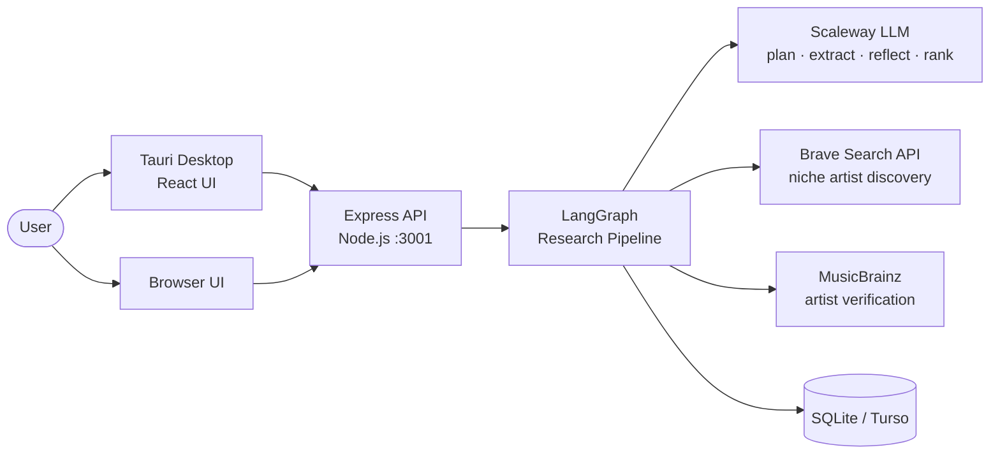
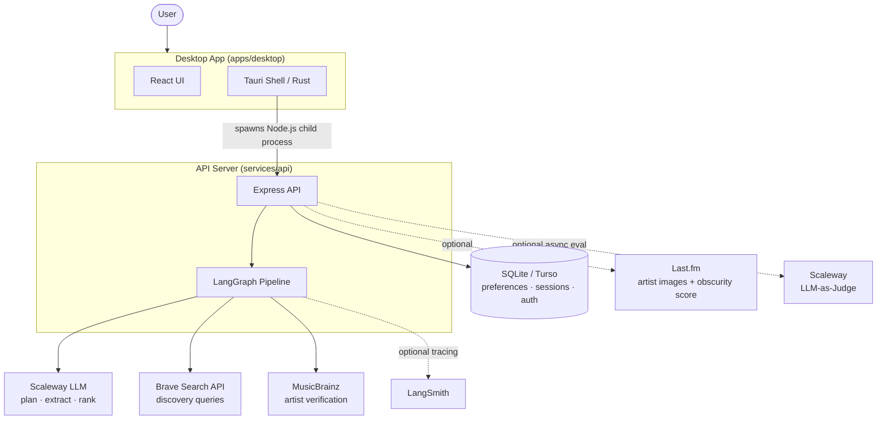
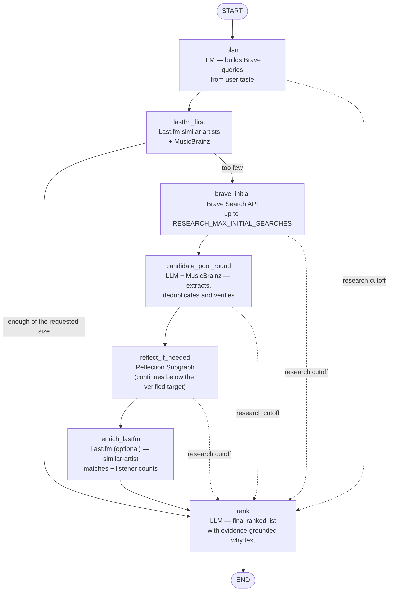
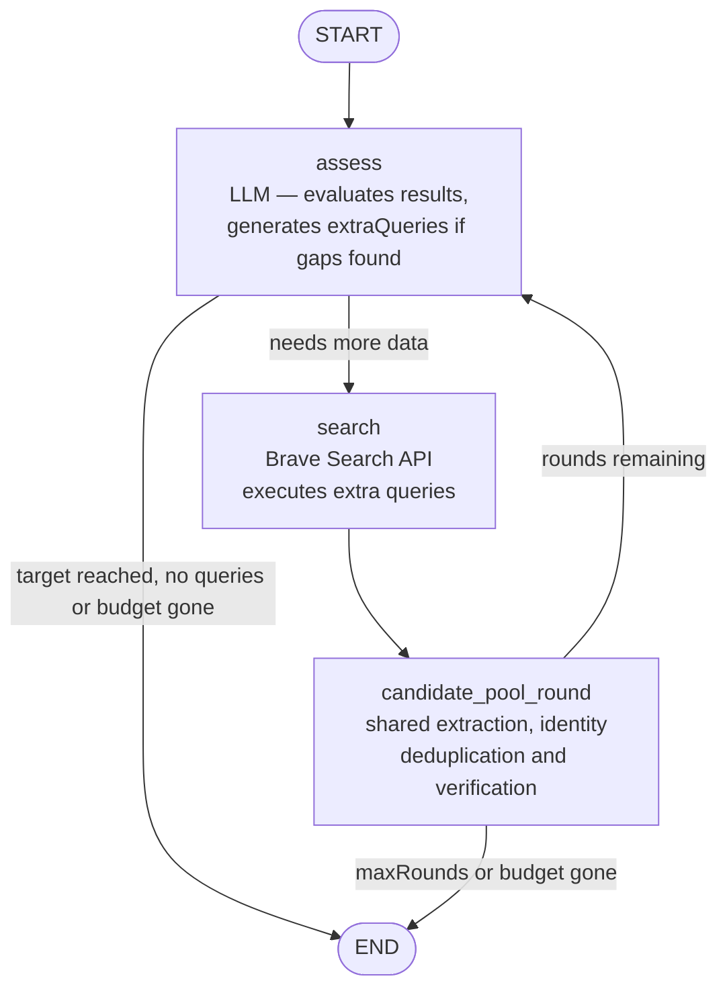
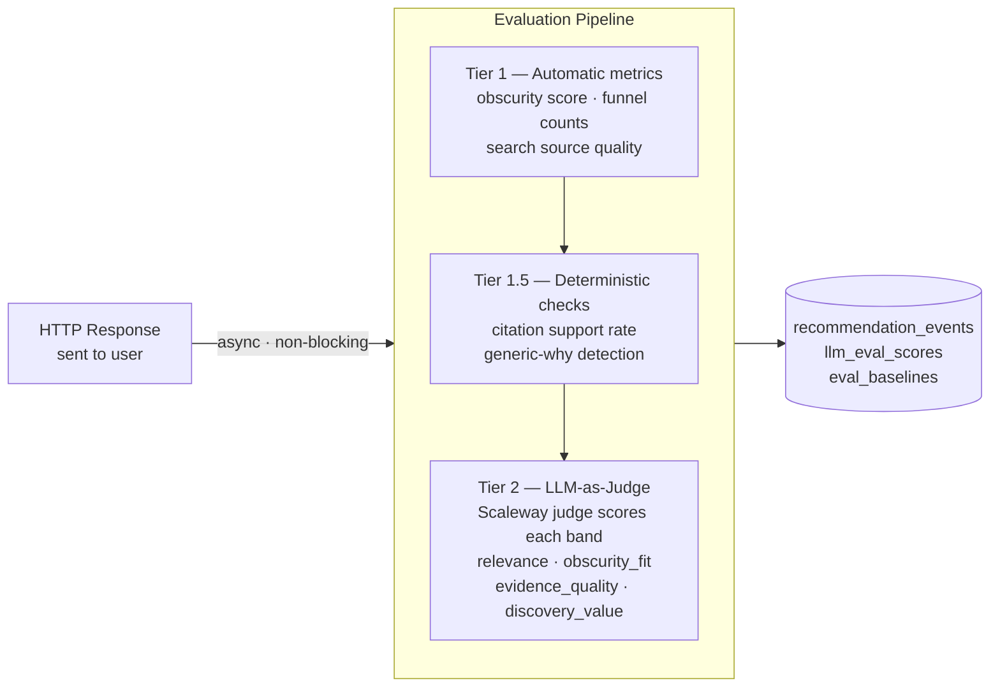
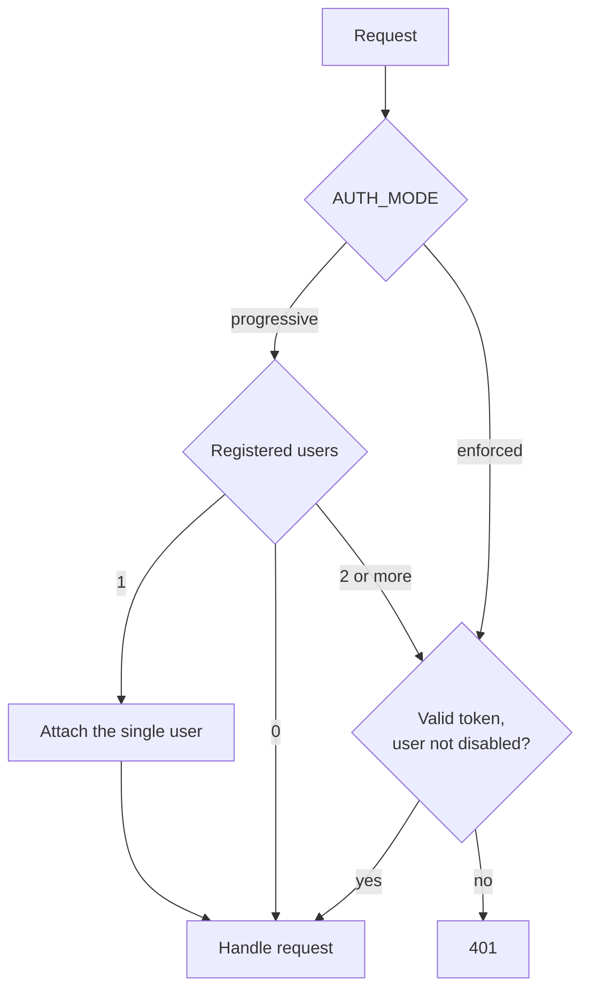

# Bandsearch Architecture

## Overview

Bandsearch is an AI-powered music recommendation system that discovers niche and lesser-known artists based on user taste. It is a monorepo containing a TypeScript/Express API backend, a Tauri+React desktop client, and shared validation contracts.

---

## System overview



---

## Monorepo structure

```
bandsearch-app/
├── apps/
│   └── desktop/         — Tauri + React desktop application (Rust + TypeScript)
├── services/
│   └── api/             — Express.js API server (TypeScript, Node.js 26+)
│   └── eval/            — Golden dataset and eval runner
├── shared/
│   └── schemas/         — Shared TypeScript validation contracts
├── docs/                — Architecture docs, ADRs, design specs, roadmap
├── scripts/             — Build and lint utilities
└── tests/               — End-to-end tests (Playwright)
```

Root `main.py` / `pyproject.toml` / `uv.lock` are an unused placeholder scaffold, kept only so `npm run lint:py` (ruff + black) has something to check — they're not part of the running application.

---

## System topology

How the pieces connect at runtime. Solid arrows are always active; dashed lines require their corresponding API key.



---

## API Server (`services/api`)

The API is an Express.js application structured as follows:

| Module | Responsibility |
|--------|---------------|
| `server.ts` | Entry point — validates env, initializes pipeline, starts HTTP listener |
| `app.ts` | Express app factory — middleware (helmet, CORS, rate-limit, JSON logging) and route registration |
| `routes/registerBandsearchRoutes.ts` | Mounts all route handlers (auth, recommendations, preferences, sessions, artist search) |
| `recommendationPipeline.ts` | Lifecycle manager for the research graph — exposes `recommend()` and `whenReady()` |
| `agent/research/researchService.ts` | Thin wrapper around `invokeResearchGraph()` with error handling |

### REST routes

Registered by `routes/registerBandsearchRoutes.ts` (auth, recommendations, sessions, preferences, artist search) and `eval/evalRoutes.ts` (eval dashboard and data).

| Group | Routes |
|-------|--------|
| Health / version | `GET /health`, `GET /version` |
| Auth | `GET /auth/status`, `POST /auth/register`, `POST /auth/login`, `POST /auth/reset-password` |
| Recommendations | `POST /recommendations/jobs` starts a search job (rate-limited to 30 starts/minute, shared with the older route), `GET /recommendations/jobs/:id` follows it as events or returns its state, `DELETE /recommendations/jobs/:id` stops it (both 300 requests/minute) — see [Search jobs](#search-jobs); `POST /recommendations` (the older held request over the same job: JSON, or events with `Accept: text/event-stream`); every response with bands carries `meta.eventId`; `meta.turn` says how the message was answered; `POST /recommendations/:eventId/feedback` (same auth and limit) |
| Sessions | `POST /sessions`, `GET /sessions`, `GET /sessions/:id`, `POST /sessions/:id/messages` |
| Artists | `GET /artists/search`, `GET /artists/image` |
| Preferences | `GET/POST /preferences`, `PATCH/DELETE /preferences/:id`, `GET /preferences/context`, `GET /preferences/export`, `POST /preferences/import`, `POST /preferences/turso/test` |
| Preference groups | `GET/POST /preferences/groups`, `POST /preferences/groups/auto`, `PATCH/DELETE /preferences/groups/:id`, `POST /preferences/groups/:id/artists`, `DELETE /preferences/groups/:id/artists/:savedBandId` |
| Account (GDPR) | `GET /account/export` (Art. 15/20 data export), `POST /account/delete` (Art. 17 erasure, password-confirmed) — see [README § Privacy & transparency](../../README.md#privacy--transparency) |
| Eval (404 unless `EVAL_DASHBOARD_ENABLED=true`) | `GET /eval/events`, `GET /eval/metrics`, `POST /eval/baseline`, `GET /eval/baselines`, `GET /eval/dashboard` (Basic Auth if `EVAL_DASHBOARD_PASSWORD` is set) |

---

## Conversation turns

Not every message needs a search. `agent/conversation/conversationService.ts`
decides how a message is answered (`TurnKind`, reported as `meta.turn`):

| Turn | When | What runs | Typical time |
|---|---|---|---|
| `search` | first message, new taste or reference artists, hard facts, changed obscurity target, too few unseen bands | the whole research graph below | 10–13 s |
| `pick` | the user wants more or different bands and the latest search still holds at least three unseen ones | the ranker, over the unseen bands after the obscurity filter | 2 s |
| `answer` | a question about shown bands or music, thanks, small talk | one model call, grounded in the shown bands' evidence | 1 s |

`turnRouter.ts` asks the research model (about 0.3 s) with the latest picks in
order and the unseen bands with their tags. Anything doubtful, a failed router
or a pick without result becomes a search. Bands already shown in the
conversation are never shown again, by a pick or by a new search.

`conversationMemory.ts` keeps the found bands per user and conversation
(`conversationId` in the request, chosen by the client) in memory for two hours;
never the user's words, never in a database, and not linked to eval telemetry.
Deleting an account clears them. After a restart a follow-up simply searches.
A request without a `conversationId` (golden runs) always searches.

An `answer` carries no `meta.eventId`: it is no batch to rate or score.

### Search jobs

A message is answered by a search job (ADR 0006): `routes/recommendationRoutes.ts`
validates it and hands one function — pipeline call, eval hook, provenance — to
the job store, `searchJobs/searchJobs.ts`, which runs it whether or not anyone
listens. The store is in memory: ids of 128 random bits, owner-checked on every
call (someone else's job is a 404), one running job per user, finished jobs kept
an hour, bounded in jobs and events. A restart loses them.

`AnswerEvent`s (shared contracts): `progress` per stage, `reply` with the text
so far, then `done` with the response, `error` (the same public error a JSON
request gets, mapped once by `recommendationFailure`) or `cancelled`. Only the
end is final; a reply shown before it may still be discarded. A job keeps a
reply as its latest text only.

- `POST /recommendations/jobs` → `202 { jobId }` with `Location`.
- `GET /recommendations/jobs/:id`, `Accept: text/event-stream`: the events after
  `Last-Event-ID` (or `?after=`), then live ones until the end, each with its
  `id:`; a comment every 15 s keeps proxies and the app from taking a quiet
  search for a dead connection. Without that header: `SearchJobState` as JSON.
- `DELETE /recommendations/jobs/:id` → 204: Stop. Closing a connection only
  stops following.
- `POST /recommendations`: starts the same job and follows it over the request,
  in JSON or as events (a request that fails or finishes before its first event
  gets plain JSON with its status). Hanging up does not stop it.

The app (`chatClient.followSearch`) re-attaches after the last event it saw when
a connection fails, ends early or is quiet for 45 s, and keeps the job id on the
device to pick the search up after the system stopped the app.

The ranker still answers in JSON; its reply is the first field and is read out
of the unfinished text (`replySoFar`), so prompts and eval are the same either
way.

---

## LangGraph pipeline

The core recommendation logic is a LangGraph state machine defined in `agent/research/researchGraph.ts`.

### Graph state (`ResearchGraphState`)

| Field | Type | Description |
|-------|------|-------------|
| `userQuery` | `string` | Raw user input |
| `preferenceContext` | `string` | Formatted saved-band context |
| `messages` | `ChatMessage[]` | Conversation history |
| `mode` | `RecommendationMode` | `fresh` or `preference-aware` |
| `obscurityTarget` | `string` (optional) | User-selected obscurity target (`Cult Following` / `Underground` / `Truly Obscure`); filters candidates before ranking |
| `searchPlan` | `SearchPlan` | Planner output (anchor artists, style signals, queries) |
| `braveHits` | `SearchHitInput[]` | Raw web search results |
| `extractedCandidates` | `ExtractedCandidate[]` | Band names extracted from snippets |
| `verifiedCandidates` | `VerifiedCandidate[]` | MusicBrainz-verified candidates with metadata |
| `searchCallsUsed` | `number` | Brave API call counter |
| `reflectionUsed` | `boolean` | Whether reflection ran |
| `recommendations` | `unknown[]` | Final ranked output |
| `assistantReply` | `string` | Optional conversational prose |

### Main graph



| Node | Model / Service | Description |
|------|----------------|-------------|
| `plan` | LLM | Generates up to `RESEARCH_MAX_INITIAL_SEARCHES` targeted Brave queries from user taste (FFO/Bandcamp-style) |
| `lastfm_first` | Last.fm (optional), MusicBrainz | Takes the 40 bands closest to the anchors from Last.fm's similar-artist lists, verifies and enriches them. With 8 verified ones inside the target's range (12 without a target) the run goes straight to `rank` without a web search (`lastFmFirst.ts`); otherwise up to 12 in range join the web search's candidates. Skipped for Truly Obscure, which those lists hardly know, and for demands they cannot show (vocals, lyrics, instruments, labels) |
| `brave_initial` | Brave Search API | Executes up to `RESEARCH_MAX_INITIAL_SEARCHES` planned queries (12 hits each), subject to the total call budget and research deadline. All Brave calls of the process share one rate gate (Free plan: 1 request/s) |
| `candidate_pool_round` | LLM, MusicBrainz | Shared by the first search and reflection rounds. Extracts names from the round's new hits, merges evidence by artist identity and verifies new candidates. MusicBrainz searches names in batches (50 each), then retries missed names with aliases; it adds `mbid`, tags, country and life span. A candidate verifies only by the same name or alias (`artistNames.ts`) |
| `reflect_if_needed` | Reflection Subgraph | Skips assessment when the verified pool has reached the configured target (8 by default); otherwise asks for more queries and runs bounded rounds. The code-enforced target takes precedence over the model's `sufficient` answer |
| `enrich_lastfm` | Last.fm (optional) | Adds similar-artist matches (vs. anchor artists), listener counts, listener tags and the start of the biography (evidence with the artist's page as source) to verified candidates; no-op if `LASTFM_API_KEY` unset. The lookups start when a name is known (`plan`, `extract`) and run alongside the other stages; this node waits at most 5 s for the rest and keeps every answer that arrived (`lastFmEnrichment.ts`) |
| `rank` | LLM | Produces final ranked list with evidence-grounded `why` text and optional prose reply |

### Reflection subgraph (`reflectionSubgraph.ts`)

Embedded as a compiled LangGraph subgraph within `reflect_if_needed`. It skips the reflector once the code-owned target of verified candidates is met. Below target, the reflector supplies queries and each additional search goes through the same `candidate_pool_round` module as the first search. It can run up to `maxRounds` (default 2) additional rounds while the total call budget remains and at least 25 s of research time remain.



| Node | Model / Service | Description |
|------|----------------|-------------|
| `assess` | LLM | Evaluates current results and generates `extraQueries`. Its `sufficient` flag cannot override the target; code stops only when the verified count reaches the target or the search-call budget is spent |
| `search` | Brave Search API | Executes extra queries against remaining budget; stores new hits in `newHits` separately from the accumulated `braveHits` |
| `candidate_pool_round` | LLM, MusicBrainz | Calls the shared `candidatePoolRound.ts` implementation on `newHits`; it applies the same extraction, identity deduplication, evidence merge and verification rules as the first search |

### Artist cache (`researchCache.ts`)

MusicBrainz matches, Last.fm listener counts and similar artists are remembered
in memory for a day, per process and by artist name. Failed lookups are not
remembered. The cache holds public artist data only.

### Budget management (`researchBudget.ts`)

`ResearchBudget` owns the complete graph deadline (`RESEARCH_TIMEOUT_MS`, default
180 s), operation caps, abort signals and timer cleanup. Its `run(cap, work)`
limits the whole operation, including retries, even if a transport ignores
cancellation. The graph closes every scope on success or failure.

A child research scope ends up to 20 s (`RANKING_RESERVE_MS`) early, reserving at most one third of a
small configured budget for final ranking. Main-graph conditional edges bypass
remaining research stages and enter `rank` at that cutoff. Last.fm lookups still under way are cancelled there. Verification keeps
completed candidates and stops between batches; optional reflection and
Last.fm enrichment cannot consume the reserve. Model calls and HTTP requests
receive abort signals; retries and Brave/MusicBrainz rate-limit waits stop when
cancelled. Graph-level JSON repair retries stay inside the shared cap. Brave diagnostics count attempted queries, including cancelled ones.

Ranking, including its evidence-repair retry, shares one 20 s cap and must finish
before the total deadline. A follow-up pick asks the same ranker and gets the same
20 s. `research_ranked` logs how long ranking took and how many answers it needed;
`research_rank_failed` logs the same when it fails (#369). A failed or timed-out ranker fails the request with the route's generic
`502 recommendation_unavailable`; it does not fabricate recommendations from
partial research. A successful ranker can still return an
empty discovery result.

---

## External Integrations

| Integration | Used in | Purpose |
|-------------|---------|--------|
| **Brave Search API** | `brave_initial`, `search` | Web discovery for niche and underground artists |
| **Scaleway Generative APIs** (`@langchain/openai`, OpenAI-compatible) | `plan`, `candidate_pool_round`, `assess`, `rank` (since 2026-10-05; the only provider since #303); the LLM judge | Research model `SCW_MODEL`, judge `SCW_JUDGE_MODEL` — see [ADR 0004](../adr/0004-llm-models-per-role-on-scaleway.md) |
| **MusicBrainz** | `candidate_pool_round` | Artist verification (mbid, tags, country, life span). One request a second per IP; a `503` (servers busy) is retried in its own slot |
| **Wikidata + Last.fm** | `/artists/image` endpoint, `enrich_lastfm` node | Artist image resolution with Last.fm fallback; similar-artist matches and listener counts feeding the ranker |
| **LangSmith** (optional) | Graph invocation | Distributed tracing for the LangGraph pipeline |

---

## Evaluation layer

An async, non-blocking quality-scoring system that runs after the HTTP response is sent. Full design in [2026-05-29-eval-architecture.md](2026-05-29-eval-architecture.md).



| Tier | Mechanism | When | Signals |
|-------|-----------|------|---------|
| **1 — Automatic metrics** | Runs immediately | After every request | Obscurity score (Last.fm listener count), funnel counts (hits / extracted / verified), search source quality |
| **1.5 — Deterministic checks** | Runs immediately | After every request | Citation support rate (evidence URLs per recommendation), generic-why detection |
| **2 — LLM-as-Judge** | Async, fire-and-forget | When `SCW_SECRET_KEY` is set (and eval is enabled) | The Scaleway judge (`SCW_JUDGE_MODEL`) scores each band on `relevance`, `obscurity_fit`, `evidence_quality`, `discovery_value` |
Eval data is stored in `recommendation_events`, `llm_eval_scores` and `eval_baselines`, in a local SQLite file (never Turso) and only while `EVAL_DASHBOARD_ENABLED=true`; otherwise the eval store is a no-op.

A dashboard at `GET /eval/dashboard` visualizes this data; set `EVAL_DASHBOARD_ENABLED=true` to expose it, and `EVAL_DASHBOARD_PASSWORD` to gate it behind HTTP Basic Auth (recommended whenever the API is publicly reachable — see `.env.example`).

Recommendation feedback (the one-tap batch reactions) is not eval data
(#307). It lives
with the account data, works with the dashboard off, and is read with
`npm run feedback:list`; see [Storage](#storage).

The `services/eval` workspace holds the golden dataset (`golden-set.json`), judge calibration data, and `run-golden.ts`/`run-calibration.ts` runners for evaluating the pipeline offline, outside of live traffic.

> **Judge provider history.** Designed for Claude; built on Mistral (until 2026-08-31 the Mistral key was wrongly posted to Anthropic, and `model_id` stayed hard-coded to `claude-opus-4-8` until 2026-09-04); **moved to Scaleway on 2026-10-05** together with calibration, which until then still called Anthropic and never ran. Both now use the same call (`judgeBands`) and the same configured model (#237, #204, [ADR 0004](../adr/0004-llm-models-per-role-on-scaleway.md)).

---

## Storage

`storage/createStorage.ts` assembles preferences, users, invites, chat sessions,
recommendation feedback and account export/erasure as one `StorageRepositories`
set, and selects the eval store beside it (a no-op with the dashboard off,
otherwise a local SQLite file on its own connection, memory on a memory
install, never Turso). `server.ts` awaits
`openStorage()` and passes that complete set to `createApp()` and its preference
repository to the recommendation pipeline. Consumers still receive only the
repository interfaces they use. The admin CLI (`scripts/admin.ts`) opens the
same stores through `openAdminStorage()`, which goes to the cloud database
directly under `turso-sync` and refuses a memory store.

Recommendation feedback (`feedback/`) keeps one row per event and user with the
batch it judges (query, mode, obscurity target, bands shown). Account export and
erasure cover it through the shared `USER_SCOPED_TABLES` list, in the same
database as the rest of the account. `createApp()` purges rows older than 90
days at startup and daily. SQLite adapters replace the old eval-era table shape
in place; Turso gets the new table from migration `006`.

`createStorage()` supports synchronous SQLite, memory and direct Turso setup;
`openStorage()` additionally opens the asynchronous sync replica. Direct Turso
and the replica share `createTursoRepositories()` so neither can omit the account
data store. Each set uses one client, or one SQLite connection with foreign keys
enabled. SQLite schema initialization lives with the adapters, including the
saved-band schema formerly initialized by the standalone preference factory.

The existing individual `createApp()` repository overrides remain available for
tests. An override replaces only that repository; it does not change the backend
of the remaining defaults. Supplying custom repositories is an explicit choice:
the caller must supply compatible account export/erasure when needed. Supplying
a complete `storage` set takes precedence over individual overrides. An
incomplete sync set or an unavailable selected database refuses startup; account
repositories never silently fall back to another database or memory.

### Preferences store (`PREFERENCE_STORE`)

| Backend | Config | Use case |
|---------|--------|----------|
| `sqlite` (default) | `DATABASE_PATH` | Local, zero-config |
| `memory` | — | Ephemeral / testing |
| `turso` | `TURSO_DATABASE_URL` + `TURSO_AUTH_TOKEN` | Cross-device cloud sync — every statement over the network |
| `turso-sync` | `TURSO_DATABASE_URL` + `TURSO_AUTH_TOKEN` + `TURSO_SYNC_PATH` | Local replica synced with Turso Cloud — reads/writes stay local, so the app keeps working offline |

Tables: `saved_bands` (rating, categories, notes), `artist_groups`

### Session store

Selected alongside preferences: SQLite (`DATABASE_PATH`, default
`bandsearch.db`), memory, direct Turso or the sync replica. Tables:
`chat_sessions`, `chat_messages`.

### Auth store

Same backend as preferences. Tables: `users` (bcrypt-hashed passwords, `disabled_at`) and `invites` (SHA-256 hashed codes bound to one email). JWTs with 30-day expiry; password recovery via single-use recovery codes.

Memory mode keeps all account repositories and eval feedback ephemeral and has
no durable account export/erasure (`userDataStore: null`). Optional eval telemetry
retains its local store because feedback references its events. The
recommendation-feedback module composes that store with account export/erasure
for SQLite, Turso and the sync replica. The local store remains readable when
the dashboard is disabled; dashboard visibility does not remove existing
account data. Startup refuses an unavailable local feedback store rather than
substituting an empty in-memory store.

---

## Authentication

`AUTH_MODE` selects one of two modes (default `progressive`).

**`progressive`** (personal install) — determined by the number of registered users at runtime:

| Users registered | Mode |
|-----------------|------|
| 0 | Pass-through — no auth checks |
| 1 | Auto-attach — all requests associated with the single user |
| ≥ 2 | Enforced — `Authorization: Bearer <token>` required for preference endpoints |

**`enforced`** (closed beta, used by `render.yaml`; [ADR 0005](../adr/0005-closed-beta-via-email-bound-invites.md)) — every protected request needs a valid token for an existing, non-disabled user; `/health`, `/version` and `/auth/*` stay public. `JWT_SECRET` is required, and `POST /auth/register` needs an email-bound, single-use invite code. `REGISTRATION_OPEN=false` closes registration in either mode.



---

## Desktop client (`apps/desktop`)

- **Stack:** Tauri (Rust shell) + React (TypeScript)
- **API process:** spawned as a Node.js child process; production builds use a Tauri-bundled Node sidecar
- **Screens:** Welcome, Login, Register, Reset Password, Chat, Saved Artists, Settings, Privacy policy (`#/privacy`) and a Connecting screen while the API starts (responsive layout via `matchMedia`, breakpoint 767 px), plus supporting UI like `FeedbackReactionBar` (Tier 3 eval feedback), `ObscurityTargetPicker` and `UpdateBanner` (in-app update notice)
- **API key storage:** OS config directory (`~/.config/bandsearch/config.json` on Linux)
- **Chat search path:** `chatAppModel.ts` owns the search lifecycle — submit,
  retry, cancel, loading and the last query. `chatRenderAdapter.ts` turns the
  model into view props and owns the viewport. `createDesktopReactShell.ts`
  owns what the user sees: Search and Retry share one path, so either failure
  shows the same inline error, while a stopped search settles without one. The
  mount only re-renders. `bootstrapDesktopApp.ts` reuses an unanswered question
  on retry instead of appending it again (#304).
- **Saved-band actions:** `savedBandActions.ts` owns identity matching, creation,
  rating, Category/Note updates, removal, and client collection updates. Cards
  carry a typed target with artist name, optional MusicBrainz ID, and suggested
  note through the view, mount, and shell; actions never recover identity from
  the latest assistant message. `chatAppModel.ts` uses the same matching rule for
  saved state. Before creating an uncached artist, the module reads stored bands
  to preserve annotations even when the collection has not loaded yet. The
  module orders writes by interaction so a slow Save cannot overwrite a later
  rating or annotation. Failed writes leave the next action able to run. The
  Category/Note sheet sends only fields the user edits, preserving untouched
  categories and note provenance (ADR 0002).

---

## Prompt guards

`agent/promptGuards.ts` wraps all user-controlled content before sending to models — escapes special characters, formats preference context blocks, and structures conversation history to prevent prompt injection. See [ADR 0001](../adr/0001-prompt-injection-guardrails.md) for the design rationale.

---

## Key design decisions

| Decision | Rationale |
|----------|----------|
| **One model for all graph nodes, chosen per role** | Consistent structured-JSON output across plan / extract / reflect / rank; each node keeps its own temperature (planner 0.2, extractor 0.1, reflector 0.15, ranker 0.35); provider and model come from `config/models.ts` (Scaleway `deepseek-v4-flash-0731` by default, ADR 0004) |
| **Optional async judge on Scaleway** | Keeps the LLM judge off the critical response path; never the research model and preferably another family, against self-evaluation bias; calibration uses the same call and model, so its result describes the production judge; eval can be added/removed without touching the graph |
| **Budget-aware graph** | Complete graph deadline and cancellation owned by `researchBudget.ts`; research stages preserve time for final ranking, whose retries share one cap |
| **Pluggable storage** | Abstract repository pattern allows SQLite → Turso swap without touching business logic |
| **Progressive auth** | Single-user deployments require no configuration; auth activates as users are added |
| **Dedup cache for Brave** | `BraveDedupCache` (Map) prevents redundant API calls within a single recommendation request |
| **Reflection as nested subgraph** | LangGraph subgraph encapsulates the reflection loop's own state and conditional edges cleanly, keeping the main graph linear |
| **Symmetric merge helpers** | `mergeExtractedCandidates` and `mergeVerifiedCandidates` follow the same contract (flat array → deduped array); reused across reflection rounds and as a defensive layer inside `formatEvidenceForPrompt` |
| **Defensive ranker dedup** | `formatEvidenceForPrompt` deduplicates `verifiedCandidates` by `mbid › canonicalName › name` before building the LLM evidence block, regardless of upstream state |
